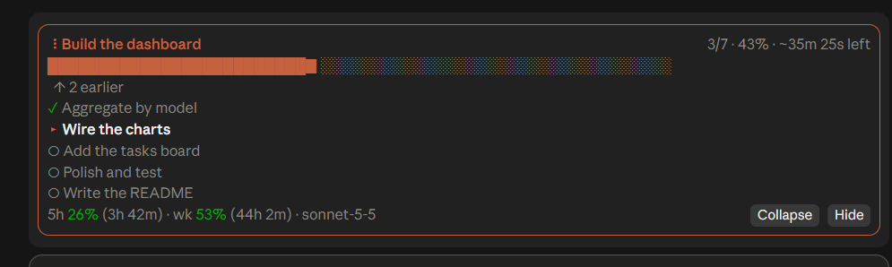

# claude-mods

Two small Claude Code mods (plugins of function hooks):

| Mod | What it adds |
|---|---|
| **task-progress** | A progress band above the prompt. It follows the todo list by itself, gives Claude a `progress` tool to report steps, shows a live "working" timer, and carries your 5h / weekly usage and the active model. `/progress` hides or shows it. |
| **usage-dashboard** | A `/usage-dashboard` pane: 5-hour and weekly limit gauges with reset times, burn rate and limit risk, per-model tokens and estimated cost, tasks with a time-left estimate, and a 7-day chart. A short `5h 34% · wk 12% · opus-5-5` status line shows after your first reply. |

## What it looks like

**task-progress**: the band above the prompt



**usage-dashboard**: the `/usage-dashboard` pane

> Illustrative text preview with sample numbers, not a screenshot. A real screenshot will replace it.

```
Claude usage                                     updated 12s ago
╭──────────────────────────────────────────────────────────────────╮
│ 5-hour session                                  resets in 2h 10m │
│ ██████████████▌░░░░░░░░░░░░░░░░░░░░░░░░░  35%                    │
│ burning 0.40%/min · full in ~2h 5m                               │
╰──────────────────────────────────────────────────────────────────╯
╭──────────────────────────────────────────────────────────────────╮
│ Weekly                                           resets in 4d 3h │
│ █████░░░░░░░░░░░░░░░░░░░░░░░░░░░░░░░░░░░  12%                    │
╰──────────────────────────────────────────────────────────────────╯
● Limit risk green   session cost ~$1.42
╭──────────────────────────────────────────────────────────────────╮
│ Models                                 active: opus-5-5 (3m ago) │
│ ★ opus-5-5    ████████░░   78%    1.2M   34 msgs  ~$0.91         │
│   sonnet-5-5  ██░░░░░░░░   22%    340k   12 msgs  ~$0.18         │
│ tokens: in / out / cache = 80k / 190k / 1.3M                     │
╰──────────────────────────────────────────────────────────────────╯
╭──────────────────────────────────────────────────────────────────╮
│ Tasks  ▸ 1 in progress   ○ 3 pending   ✓ 2 today                 │
│ ▸ Wire the charts  1m 20s                                        │
│ ○ Add the tasks board                                            │
│ ○ Polish and test                                                │
│ Time left 25m (best case 14m) · confidence medium, 4 finished    │
│ Should finish within the current 5h window.                      │
╰──────────────────────────────────────────────────────────────────╯
╭──────────────────────────────────────────────────────────────────╮
│ Last 7 days                                                      │
│ Wed 07 ██████████████████░░░░░░░░░░░░░░░░░░░░░░  420k            │
│ Thu 08 ███████████████████████████████░░░░░░░░░  740k            │
│ Fri 09 ██████████░░░░░░░░░░░░░░░░░░░░░░░░░░░░░░  240k            │
│ Sat 10 ░░░░░░░░░░░░░░░░░░░░░░░░░░░░░░░░░░░░░░░░  0               │
│ Sun 11 ██████████████████████░░░░░░░░░░░░░░░░░░  530k            │
│ Mon 12 ████████████████████████████████████████  1.0M            │
╰──────────────────────────────────────────────────────────────────╯
```

## Install

In a terminal Claude Code session (the desktop app's Code tab does not run `/plugin install`):

```
/plugin install task-progress --marketplace wablevaibhav/claude-mods
/plugin install usage-dashboard --marketplace wablevaibhav/claude-mods
```

Answer `y` to add the marketplace the first time, then pick a scope.

To try a mod from a clone without installing it:

```
claude --plugin-dir ./task-progress --plugin-dir ./usage-dashboard
```

## Notes and limits

- **`/usage` is Claude Code's own built-in panel.** This mod's pane opens with `/usage-dashboard`, so the two don't collide.

- **Usage figures** come from the rate-limit windows Anthropic reports on each reply (`five_hour`, `seven_day`). Accounts without those windows (for example some API-key setups) show "No reading yet".
- **Model totals, daily tokens and finished-task durations** only count turns the mod has seen since you installed it. They are kept per machine.
- **Cost** is a rough per-model price table, not a bill.
- **Tasks and the time-left estimate** follow Claude's `TodoWrite` todo list. If your session tracks work with another task tool, `task-progress` can still be driven through its `progress` tool.
- The mods read no files and send nothing anywhere.

## Develop

```
claude plugin validate ./task-progress
claude plugin test ./task-progress
claude plugin validate ./usage-dashboard
claude plugin test ./usage-dashboard
```

## License

MIT, see [LICENSE](LICENSE).
